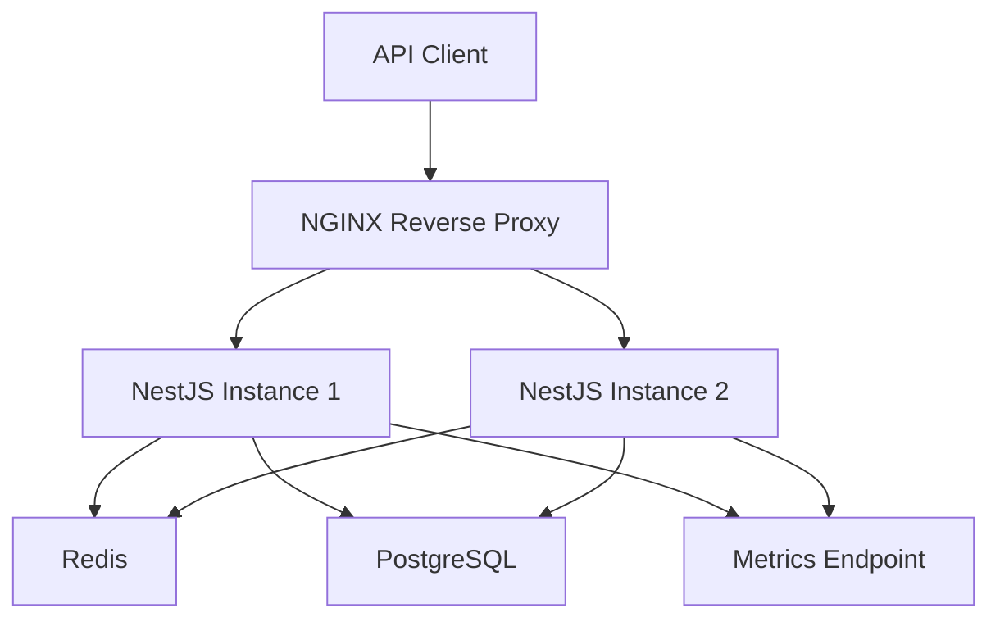

# API Rate Limiting & Security Gateway

A backend API gateway built with **NestJS, Redis, PostgreSQL, Prisma, JWT and NGINX**. The project focuses on API security, subscription-aware rate limiting, authentication, authorization, scalability and observability.

## Overview

This project demonstrates how to build a secure, scalable backend gateway that authenticates incoming requests, enforces role-based access control and applies dynamic rate limits based on user subscription plans.

It uses Redis to maintain shared rate-limit counters across multiple NestJS instances and NGINX to distribute incoming traffic.

## Architecture



## Tech Stack

| Area | Technology |
|---|---|
| Backend | NestJS, Node.js, TypeScript |
| Authentication | JWT, Passport, bcrypt |
| Authorization | Role-Based Access Control |
| Database | PostgreSQL |
| ORM | Prisma |
| Rate limiting | Redis, Sliding Window Log |
| Reverse proxy | NGINX |
| Containerization | Docker, Docker Compose |
| Application metrics | Prometheus client (`prom-client`) |

## Key Features

### 1. Authentication and Authorization
- User registration and login.
- Password hashing with bcrypt.
- JWT-based authentication.
- Protected API endpoints.
- Role-based access control with USER, DEVELOPER and ADMIN roles.

### 2. Subscription-Aware Rate Limiting

Implements dynamic request quotas based on subscription plans.

| Plan | Default request limit |
|---|---:|
| FREE | 60 requests/minute |
| PRO | 600 requests/minute |
| ENTERPRISE | 3,000 requests/minute |

Limits are configurable through environment variables.

### 3. Redis-Based Sliding Window Rate Limiting
- User-based rate limiting.
- IP-based rate limiting.
- Atomic Redis operations using Lua scripts.
- Shared rate-limit state across backend instances.
- Configurable time windows and request quotas.

### 4. API Gateway and Load Balancing
- NGINX reverse proxy.
- Multiple NestJS backend instances.
- Least-connections load-balancing strategy.
- Backend failure handling.
- Forwarded client IP handling.

### 5. Database and Reliability
- PostgreSQL persistence.
- Prisma ORM and migrations.
- Repository pattern.
- Database indexing and relational models.
- Graceful application shutdown.

### 6. Observability and Error Handling
- Correlation IDs using `X-Request-ID`.
- Structured JSON application logs.
- Request duration tracking.
- Global HTTP exception handling.
- Liveness and readiness endpoints.
- Prometheus-compatible application metrics.
- HTTP request counters, latency histograms and active-request gauges.
- Rate-limit allowed and blocked counters.
- Default Node.js runtime metrics.

## API Endpoints

Base URL: `/api/v1`

| Method | Endpoint | Purpose |
|---|---|---|
| POST | `/auth/register` | Register a user |
| POST | `/auth/login` | Authenticate a user |
| GET | `/auth/profile` | Get authenticated user profile |
| GET | `/access/user` | User-authorized endpoint |
| GET | `/access/developer` | Developer-authorized endpoint |
| GET | `/access/admin` | Admin-authorized endpoint |
| GET | `/health/live` | Application liveness |
| GET | `/health/ready` | Database and Redis readiness |
| GET | `/redis-health` | Redis connectivity check |
| GET | `/metrics` | Application metrics |
| GET | `/` | Basic application health |

Protected endpoints require a valid JWT in the Authorization header:

`Authorization: Bearer <token>`

## Running the Project

### Prerequisites
- Node.js 22+
- npm
- Docker Desktop
- Docker Compose

### 1. Clone the repository

```bash
git clone <YOUR_GITHUB_REPOSITORY_URL>
cd api-security-gateway
```

### 2. Configure environment variables

Create a local `.env` file using `.env.example` as a reference.

Configure your database URL, Redis connection, JWT secret and rate-limit settings. Never commit your real `.env` file.

### 3. Start the infrastructure and application

```bash
docker compose up --build -d
```

### 4. Check container status

```bash
docker compose ps
```

### 5. View application logs

```bash
docker compose logs -f app1
```

The API is exposed through NGINX on port `80` by default.

Example:

```text
http://localhost/api/v1/health/live
http://localhost/api/v1/health/ready
http://localhost/api/v1/metrics
```

## Configuration

The rate-limiting configuration is controlled through environment variables:

| Variable | Default |
|---|---:|
| `RATE_LIMIT_WINDOW_SECONDS` | 60 |
| `RATE_LIMIT_FREE` | 60 |
| `RATE_LIMIT_PRO` | 600 |
| `RATE_LIMIT_ENTERPRISE` | 3000 |
| `RATE_LIMIT_LOGIN` | 10 |
| `RATE_LIMIT_REGISTER` | 5 |

Invalid rate-limit configuration is rejected during application startup.

## Engineering Concepts Demonstrated

- SOLID principles and dependency injection.
- Repository pattern and service abstractions.
- Authentication versus authorization.
- Role-based access control.
- Subscription-based access policies.
- Redis atomic operations and Lua scripting.
- Sliding Window Log rate-limiting algorithm.
- Reverse proxy and load balancing.
- Containerized multi-instance deployment.
- Structured logging and application metrics.
- Health checks and graceful shutdown.

## Future Enhancements

- Prometheus server and Grafana dashboards.
- Centralized log aggregation.
- OpenTelemetry distributed tracing.
- Automated load and performance testing.
- CI/CD pipeline.
- Production deployment automation.

## Project Status

Core API gateway implementation completed. Monitoring server integration and further production-readiness enhancements are planned for a subsequent phase.

---

**Built as a hands-on backend engineering project to explore API security, distributed rate limiting and scalable service architecture.**