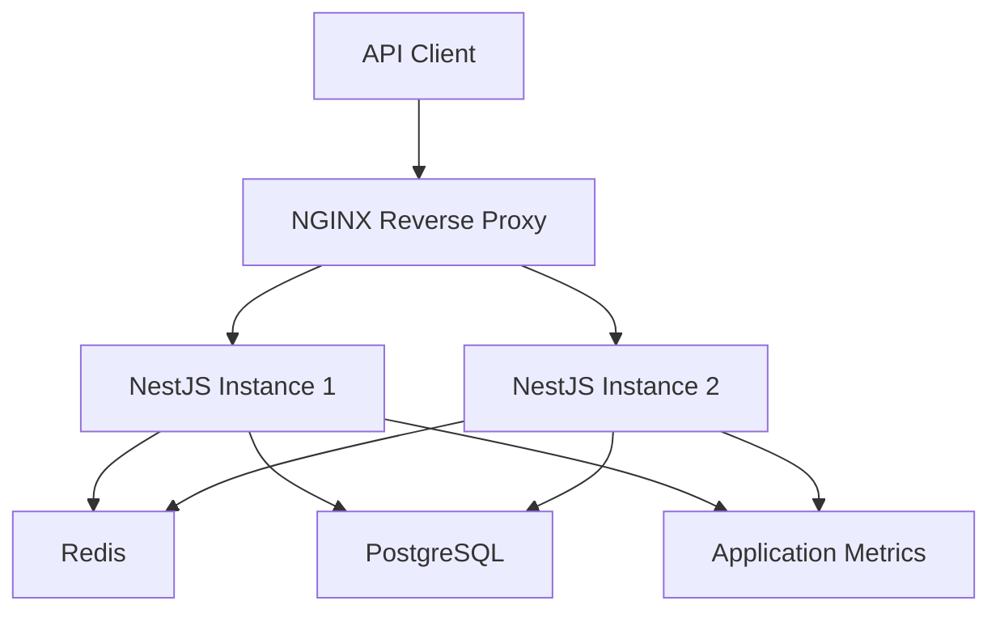

# API Rate Limiting & Security Gateway

A secure and scalable API gateway built with **NestJS, Node.js, Redis, PostgreSQL, Prisma, JWT, Docker and NGINX**.

This project demonstrates backend engineering concepts including authentication, role-based authorization, subscription-aware rate limiting, distributed request control, reverse proxying, load balancing and application observability.

## Architecture



### Request Flow

1. API clients send requests through NGINX.
2. NGINX distributes traffic between NestJS instances.
3. NestJS authenticates requests using JWT.
4. Authorization guards verify user roles.
5. Rate-limiting guards enforce user-based or IP-based quotas.
6. Redis maintains shared rate-limit counters across application instances.
7. PostgreSQL stores persistent application data.

## Technology Stack

| Category | Technology |
|---|---|
| Backend | NestJS, Node.js, TypeScript |
| Authentication | JWT, Passport, bcrypt |
| Authorization | Role-Based Access Control |
| Database | PostgreSQL |
| ORM | Prisma |
| Caching and rate limiting | Redis |
| Reverse proxy | NGINX |
| Containerization | Docker, Docker Compose |
| Application metrics | Prometheus Client |

## Features

### 1. Authentication and Authorization

- User registration and login.
- Secure password hashing using bcrypt.
- JWT-based authentication.
- Protected API endpoints.
- Role-based access control.
- USER, DEVELOPER and ADMIN roles.

### 2. Subscription-Aware Rate Limiting

Dynamic API request quotas based on subscription plans.

| Subscription | Requests per minute |
|---|---:|
| FREE | 60 |
| PRO | 600 |
| ENTERPRISE | 3,000 |

Features:
- User-based rate limiting.
- IP-based rate limiting.
- Configurable request limits.
- Rate-limit response headers.
- Environment-based configuration validation.

### 3. Redis Sliding Window Rate Limiting

Implements the Sliding Window Log algorithm using Redis.

- Atomic Redis operations using Lua scripts.
- Shared counters across multiple NestJS instances.
- Consistent rate-limit enforcement.
- Configurable time windows.
- Separate user and IP rate-limit keys.

### 4. NGINX API Gateway

- Reverse proxy configuration.
- Multiple NestJS application instances.
- Least-connections load balancing.
- Backend failure handling.
- Forwarded client IP handling.
- Health checks and graceful shutdown.

### 5. Database and Reliability

- PostgreSQL database integration.
- Prisma ORM and migrations.
- Repository pattern.
- Relational data models.
- Database indexes and unique constraints.
- Graceful database connection management.

### 6. Observability and Error Handling

- Correlation IDs using `X-Request-ID`.
- Structured JSON logging.
- Request duration tracking.
- Global HTTP exception filter.
- Application liveness and readiness endpoints.
- Prometheus-compatible metrics endpoint.
- HTTP request counters and latency histograms.
- Active request gauge.
- User-based and IP-based rate-limit metrics.
- Node.js runtime metrics.

## API Endpoints

Base path: `/api/v1`

| Method | Endpoint | Description |
|---|---|---|
| POST | `/auth/register` | Register a new user |
| POST | `/auth/login` | Authenticate a user |
| GET | `/auth/profile` | Get authenticated user profile |
| GET | `/access/user` | User-authorized endpoint |
| GET | `/access/developer` | Developer-authorized endpoint |
| GET | `/access/admin` | Admin-authorized endpoint |
| GET | `/health/live` | Application liveness check |
| GET | `/health/ready` | Database and Redis readiness check |
| GET | `/redis-health` | Redis connectivity check |
| GET | `/metrics` | Application metrics |
| GET | `/` | Basic application health |

Protected endpoints require a JWT:

```http
Authorization: Bearer <your-access-token>
```

## Project Structure

```text
api-security-gateway/
│
├── monitoring/
├── nginx/
├── prisma/
│   ├── migrations/
│   ├── schema.prisma
│   └── seed.ts
│
├── src/
│   ├── common/
│   │   ├── decorators/
│   │   ├── filters/
│   │   ├── guards/
│   │   ├── middleware/
│   │   └── logger/
│   │
│   ├── config/
│   ├── infrastructure/
│   │   └── redis/
│   │
│   ├── modules/
│   │   ├── auth/
│   │   ├── health/
│   │   ├── metrics/
│   │   └── users/
│   │
│   └── rate-limiter/
│
├── .env.example
├── .gitignore
├── docker-compose.yml
├── Dockerfile
├── prisma.config.ts
├── package.json
└── README.md
```

*The structure above is representative; adjust folder names if your repository differs.*

## Getting Started

### Prerequisites

- Node.js 22+
- npm
- Docker Desktop
- Docker Compose

### 1. Clone the repository

```bash
git clone https://github.com/Adit-Sawant/api-security-gateway.git

cd api-security-gateway
```

### 2. Configure environment variables

Create a local `.env` file using `.env.example` as a reference.

Configure:
- PostgreSQL connection URL.
- Redis connection details.
- JWT secret and expiration.
- Rate-limit settings.

Use local development credentials only. Never commit your actual `.env` file or production secrets.

### 3. Install dependencies

```bash
npm ci
```

### 4. Generate the Prisma client

```bash
npx prisma generate
```

### 5. Start infrastructure services

Start PostgreSQL and Redis:

```bash
docker compose up -d postgres redis
```

Ensure your local `.env` uses the host-accessible PostgreSQL and Redis addresses.

### 6. Apply database migrations

```bash
npx prisma migrate deploy
```

### 7. Start the complete application

```bash
docker compose up --build -d
```

### 8. Verify running containers

```bash
docker compose ps
```

### 9. View application logs

```bash
docker compose logs -f app1
```

## Application URLs

Once the Docker Compose services are running:

| Service | URL |
|---|---|
| API Gateway | `http://localhost` |
| Liveness | `http://localhost/api/v1/health/live` |
| Readiness | `http://localhost/api/v1/health/ready` |
| Redis health | `http://localhost/api/v1/redis-health` |
| Metrics | `http://localhost/api/v1/metrics` |

NGINX exposes the application through port 80 by default.

## Environment Configuration

The following rate-limit settings are configurable:

| Variable | Default |
|---|---:|
| `RATE_LIMIT_WINDOW_SECONDS` | 60 |
| `RATE_LIMIT_FREE` | 60 |
| `RATE_LIMIT_PRO` | 600 |
| `RATE_LIMIT_ENTERPRISE` | 3000 |
| `RATE_LIMIT_LOGIN` | 10 |
| `RATE_LIMIT_REGISTER` | 5 |

The application validates rate-limit configuration during startup.

Refer to `.env.example` for the complete environment variable template.

## Engineering Concepts Demonstrated

- SOLID principles.
- Dependency injection and abstraction.
- Repository pattern.
- Authentication versus authorization.
- Role-based access control.
- Subscription-based access control.
- Redis atomic operations and Lua scripting.
- Sliding Window Log rate-limiting algorithm.
- Reverse proxy and load balancing.
- Docker-based multi-instance deployment.
- Health checks and graceful shutdown.
- Structured logging and application metrics.

## Future Enhancements

- Prometheus server integration.
- Grafana dashboards.
- Centralized log aggregation.
- OpenTelemetry distributed tracing.
- Load and performance testing.
- CI/CD pipeline.
- Production deployment automation.

## Project Status

**Phase 1: Core API Gateway implementation completed.**

The application includes authentication, authorization, distributed rate limiting, containerized deployment, load balancing, health checks and application-level metrics.

Prometheus server integration, Grafana visualization and additional production-readiness enhancements are planned for a future phase.

---

## Author

**Adit Santosh Sawant**

Backend Developer | Java | Node.js | NestJS | API Security

GitHub: [Adit-Sawant](https://github.com/Adit-Sawant)

---

If you find this project useful, feel free to explore the repository and share your feedback.